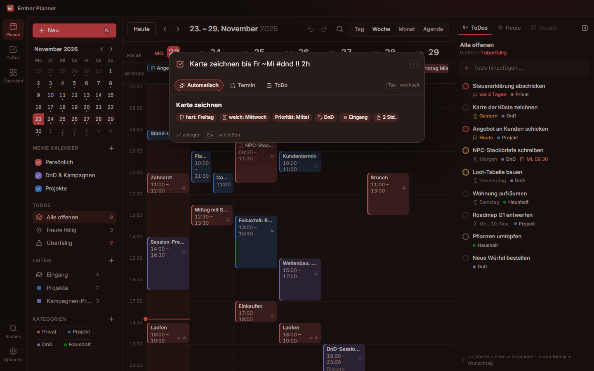
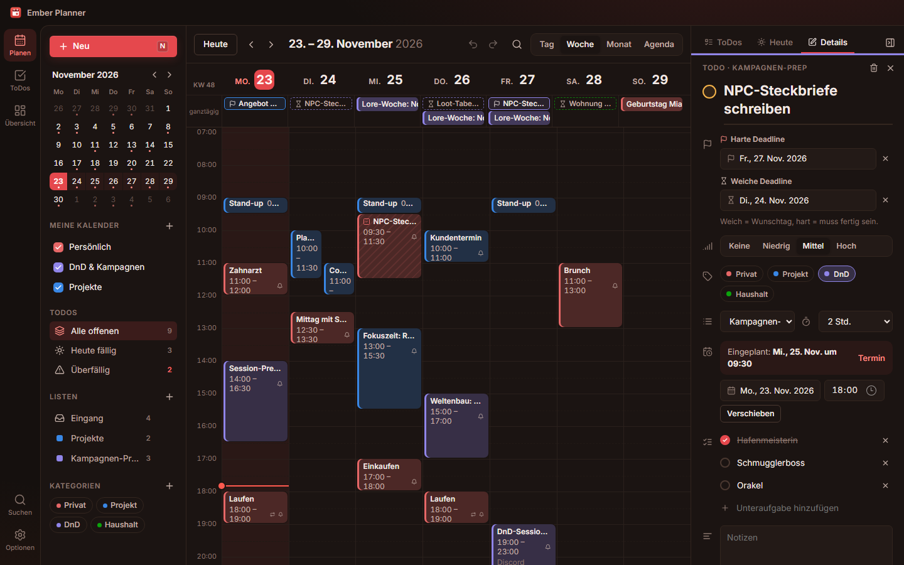
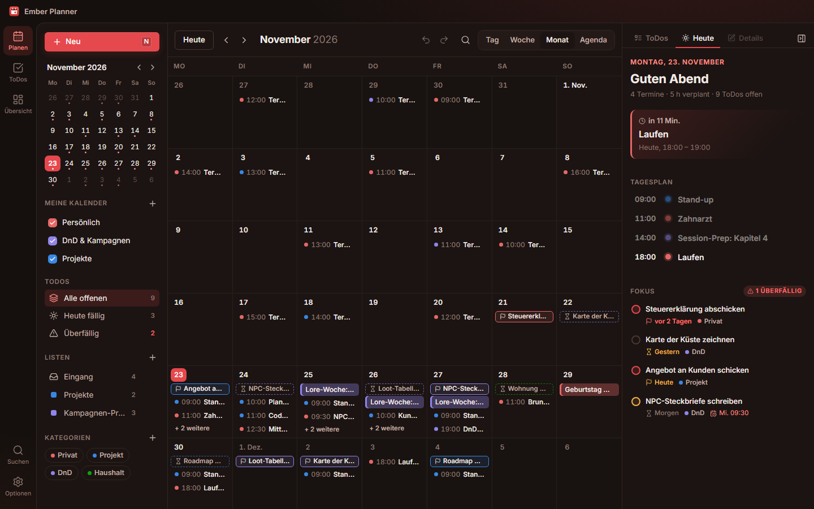
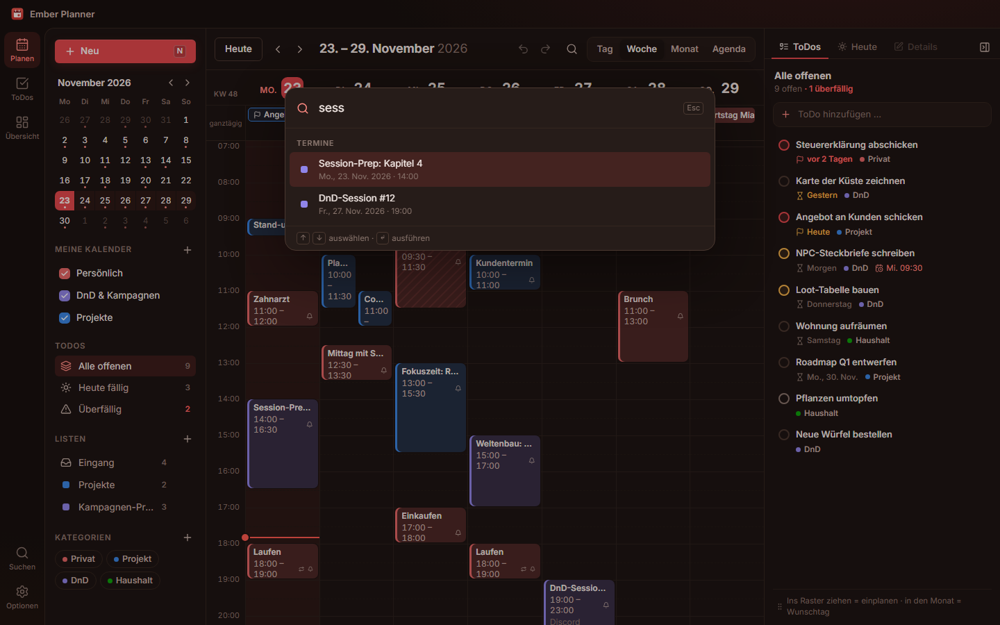
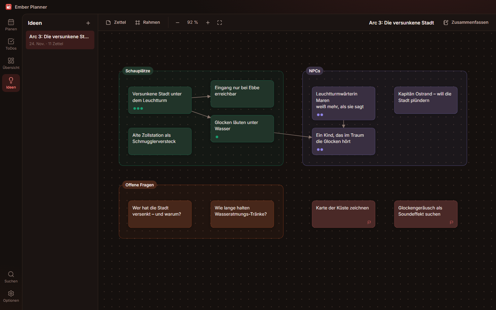

# Ember Planner

**Kalender, ToDos und Tagesplanung in einer Desktop-App – warm, schnell, tastaturfreundlich.**

Ember Planner verbindet einen vollwertigen Kalender mit ToDo-Listen, die **harte und weiche Deadlines** kennen.
ToDos zieht man direkt in den Kalender, um Zeit dafür zu blocken; alles lässt sich rückgängig machen,
und fast jede Aktion geht auch ohne Maus. Die ToDos verwenden das Format des Obsidian-Plugins „Tasks“,
damit eine spätere Obsidian-Anbindung nahtlos passt.


> Status: **frühe Version (0.3)** für Windows, als Installer baubar (`npm run dist`). Läuft lokal, Daten bleiben auf dem
> eigenen Rechner – optional mit **2-Wege-Sync zu Google Kalender**. Obsidian-Anbindung ist geplant – siehe [Roadmap](docs/ROADMAP.md).

## Highlights

- **Eine Arbeitsfläche** – Kalender in der Mitte, Filter links, rechts eine Spalte mit *ToDos*, *Heute* und *Details*
- **Kalender** – Tag, Woche, Monat, Agenda · Wiederholungen (auch einzelne Termine einer Serie ändern) · Vorlagen · Papierkorb · mehrere Erinnerungen mit Windows-Benachrichtigung und Gong · Tray
- **ToDos** – Listen, Kategorien, Prioritäten, Unteraufgaben, Zeitschätzung, harte 📅 und weiche ⏳ Deadlines, sortiert nach der frühesten Deadline · wiederkehrend · Archiv und Papierkorb
- **Einplanen per Drag & Drop** – ToDo ins Raster ziehen = Zeitblock in Länge der Schätzung · in den Monat ziehen = Wunschtag
- **Discord** – Events deiner Server im Kalender (mit Anzahl Interessierter) · Termine per Klick als Server-Event ankündigen, Änderungen und Absagen ziehen mit
- **Eine Eingabe für alles** (`N`) – „Zahnarzt Do 14 Uhr 1h“ wird ein Termin, „Karte zeichnen bis Fr ~Mi #dnd !! 2h“ ein ToDo
- **Befehlspalette** (`Strg+K`) – Termine, ToDos und Befehle durchsuchen
- **Rückgängig statt Rückfragen** – `Strg+Z` / `Strg+Y` für alles, keine „Wirklich löschen?“-Dialoge
- **Google Kalender** – 2-Wege-Sync mit eigenem Google-Konto, inkl. Serien, Erinnerungen und Offline-Warteschlange ([Einrichtung](docs/GOOGLE-SETUP.md))
- **Ideen-Boards** – Brainstorm mit Zetteln, Rahmen, Pfeilen und Punkten; Zusammenfassen und als Obsidian-Notiz (+ `.canvas`) exportieren
- **Übersicht** – Wochenauslastung, Deadline-Radar, Kategorien und Aktivitäts-Heatmap
- **Themes** – „Ember“ (dunkel) und „Rosé“ (hell), weitere Styles folgen
- **Daten in eigener Hand** – tägliche Sicherung, Export als JSON / ICS / Markdown, Import mit Rückgängig, Feiertage nach Bundesland

Alle Funktionen im Detail: **[docs/FEATURES.md](docs/FEATURES.md)**

## Screenshots

| | |
|---|---|
|  **Schnelleingabe** – erkennt Termin oder ToDo, Deadlines, Kategorie, Priorität |  **Details in der Seitenspalte** – Änderungen werden sofort gespeichert |
|  **Monatsansicht** mit Deadline-Markierungen und „Heute“-Spalte |  **ToDo-Seite** – gruppiert nach Dringlichkeit, Mehrfachauswahl |
|  **Übersicht** mit Widgets |  **Befehlspalette** (`Strg+K`) |
|  **Ideen-Board** – Zettel, Rahmen, Pfeile und Punkte; Export als Obsidian-Notiz |  **Theme „Rosé“** |

## Als Desktop-App installieren

```powershell
npm install
npm run dist
```

Das erzeugt `dist\Ember-Planner-Setup-0.5.0.exe`. Fertige Installer gibt es auch unter
[Releases](https://github.com/Xovio/ember-planner/releases). Der Installer richtet die App für den aktuellen Benutzer ein
(ohne Administratorrechte) und legt Startmenü- und Desktop-Verknüpfung an. Zum Anheften an die Taskleiste die App über das
Startmenü starten, dann Rechtsklick auf das Taskleisten-Symbol → *An Taskleiste anheften*.

- Die installierte App nutzt dieselben Daten wie `npm run dev` (`%APPDATA%\Ember Planner`).
- Der Installer ist nicht signiert; Windows SmartScreen fragt deshalb beim ersten Start nach (*Weitere Informationen → Trotzdem ausführen*).
- **Auto-Update:** Die installierte App sucht beim Start und alle 6 Stunden auf GitHub Releases nach einer neuen Version,
  lädt sie im Hintergrund und installiert sie beim Beenden – oder sofort über *Optionen → Updates → Jetzt neu starten*.
  Abschaltbar unter *Optionen → Updates*.
- Lokale Code-Änderungen ohne Release: `npm run dist` erneut ausführen und den neuen Installer drüberinstallieren.
- `npm run pack` baut nur den Ordner `dist\win-unpacked` (schneller, ohne Installer) – zum Ausprobieren.
- Das App-Icon wird aus Code gezeichnet; `npm run icon` erzeugt daraus `build\icon.ico`.

> Wer früher während `npm run dev` das Fenster angeheftet hat, hat damit `electron.exe` angeheftet – das öffnet nur das leere
> Electron. Dieses Symbol lösen und die installierte App anheften. Entwicklungsstarts haben jetzt eine eigene
> Taskleisten-Kennung, damit das nicht wieder passiert.

### Neue Version veröffentlichen

1. `version` in `package.json` erhöhen (z. B. `0.2.0`), committen und nach `master` bringen.
2. Tag setzen und pushen:

   ```powershell
   git tag v0.2.0
   git push origin v0.2.0
   ```

3. Die GitHub Action *Release* prüft und testet, legt einen Release-Entwurf an, lädt Installer, `.blockmap` und
   `latest.yml` hoch und veröffentlicht den Entwurf erst, wenn alle drei Dateien da sind.
   Installierte Apps finden die Version danach von selbst.

Ohne GitHub Action geht es auch lokal: `$env:GH_TOKEN = '<token>'; npm run release` (Token mit Schreibrecht auf das Repo).
Das legt einen *Entwurf* an; veröffentlicht wird er auf GitHub von Hand.

## Installation (aus dem Quellcode)

Voraussetzungen: [Node.js](https://nodejs.org) 22 oder neuer, Git, Windows 10/11.

```powershell
git clone https://github.com/Xovio/ember-planner.git
cd ember-planner
npm install
npm run dev
```

| Befehl | Zweck |
|---|---|
| `npm run dev` | Desktop-App mit Hot-Reload |
| `npm run build` / `npm run start` | Produktions-Bundle bauen / starten |
| `npm run dist` / `npm run pack` | Windows-Installer bauen / nur entpackte App in `dist\win-unpacked` |
| `npm run release` | Installer bauen und als Release-Entwurf hochladen (braucht `GH_TOKEN`; normalerweise über Tag + Action) |
| `npm run web` | Nur die Oberfläche im Browser (http://localhost:5199) – mit `?demo` und Beispieldaten |
| `npm run typecheck` | TypeScript prüfen |
| `npm test` | Automatisierte Tests (Vitest) |

<details>
<summary>Electron startet nicht („Electron failed to install correctly“)?</summary>

Neuere npm-Versionen führen Install-Skripte erst nach Freigabe aus:

```powershell
npm install-scripts approve electron esbuild
npm rebuild electron esbuild
```

Falls `node_modules\electron\dist\electron.exe` danach immer noch fehlt, das heruntergeladene Zip aus
`%LOCALAPPDATA%\electron\Cache` nach `node_modules\electron\dist` entpacken und in
`node_modules\electron\path.txt` den Text `electron.exe` eintragen.
</details>

Die Daten liegen in `%APPDATA%\Ember Planner\data.json`, tägliche Sicherungen in `%APPDATA%\Ember Planner\Backups`.
Export, Import und Wiederherstellen: *Optionen → Daten*.

## Bedienung in Kürze

| Kürzel | Aktion |
|---|---|
| `N` / `Strg+Leertaste` | Neu anlegen (mit Uhrzeit → Termin, sonst ToDo; `Tab` wechselt) |
| `Strg+K` / `/` | Suchen & Befehle |
| `Strg+Z` / `Strg+Y` | Rückgängig / Wiederholen |
| `T` · `D` `W` `M` `A` · `←` `→` | Heute · Ansicht · blättern |
| `H` · `B` | Seitenspalte „Heute“ · Seitenspalte ein/aus |
| `Entf` | Ausgewählten Termin löschen / ToDo in den Papierkorb |
| `?` | Alle Tastenkürzel anzeigen |
| ToDo-Seite: `↑` `↓`, `Leertaste`, `0`–`3` | wählen, abhaken, Priorität · Strg/Shift+Klick = Mehrfachauswahl |
| Ideen: Doppelklick / `N`, `Enter`, `Tab`, `G` | Zettel · verbundener Zettel · Zettel darunter · Rahmen um Auswahl |

**Maus:** Klick ins Raster → Schnell-Anlegen · Klick auf Termin → Vorschau · Doppelklick → Details · Rechtsklick → Menü ·
ToDo ins Raster ziehen → einplanen · Deadline-Markierung ziehen → Deadline verschieben · ToDo auf eine Liste ziehen → verschieben

### Schnelleingabe für ToDos

| Eingabe | Bedeutung |
|---|---|
| `bis Freitag`, `bis Fr`, `morgen`, `3.12.`, `in 2 Wochen` | harte Deadline (📅) |
| `~Mittwoch`, `~Mi`, `ca. 1.12.` | weiche Deadline (⏳) |
| `#name` · `@liste` | Kategorie (wird angelegt, falls neu) · Liste |
| `!` / `!!` / `!!!` | Priorität niedrig / mittel / hoch |
| `30m`, `90min`, `2h` | Zeitschätzung |
| `täglich`, `jede Woche`, `alle 2 Wochen`, `monatlich`, `jeden Mo` | wiederkehrendes ToDo |
| `📅 2026-11-30 ⏳ 2026-11-27 ⏫` | Obsidian-Tasks-Syntax geht auch |

## Technik

Electron · React 19 · TypeScript · Vite (electron-vite) · Zustand · date-fns · rrule · lucide-react · Vitest.
Daten als JSON-Datei hinter einer Repository-Schicht (später SQLite möglich). Aufbau und Designentscheidungen:
[docs/DESIGN.md](docs/DESIGN.md).

| Ordner | Inhalt |
|---|---|
| `src/main` | Hauptprozess: Fenster, Tray, Datenspeicher, Erinnerungs-Scheduler |
| `src/main/google` | Google-Anmeldung (OAuth/PKCE), Abgleich, Outbox fürs Hochladen |
| `src/preload` | sichere IPC-Brücke (`window.api`) |
| `src/shared` | Datentypen, Wiederholungen, ToDo-/Tasks-Format-Logik |
| `src/renderer` | Oberfläche: Seiten, Kalenderansichten, Details, Widgets, Themes |
| `scripts/screenshots.ps1` | erzeugt die README-Screenshots aus dem Demo-Modus |

## Dokumentation

- [Funktionen & Umfang](docs/FEATURES.md)
- [Roadmap, Ideen & Ziele](docs/ROADMAP.md)
- [Designkonzept & Recherche](docs/DESIGN.md)
- [Google Kalender einrichten](docs/GOOGLE-SETUP.md) · [Sync-Konzept](docs/GOOGLE-SYNC.md)

## Lizenz

[MIT](LICENSE) © 2026 Xovio
